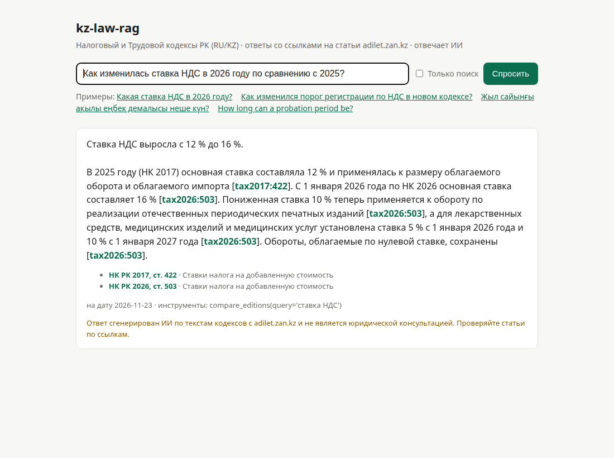
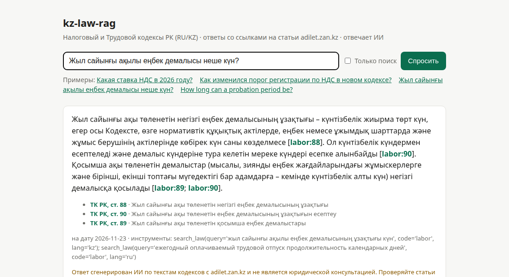
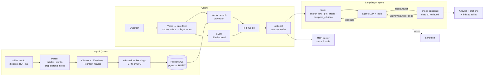

# kz-law-rag: cited answers from the Tax and Labour codes of Kazakhstan

A RAG assistant over the **Tax Code of Kazakhstan 2026**, the **previous Tax Code (2018–2025)** and the **Labour Code**, in Russian and Kazakh. Every claim in an answer cites the article it comes from (`[tax2026:503]`) with a link to the official text on [adilet.zan.kz](https://adilet.zan.kz). The same tools are available as an **MCP server** for Claude Desktop, Claude Code and other MCP clients.

Built solo in November 2026 as an engineering portfolio project. Not legal advice.



<details><summary>The same in Kazakh: the agent searched in Kazakh, then rephrased into Russian legal wording</summary>



</details>

## Why this problem

On 1 January 2026 a new Tax Code came into force: VAT went from 12% to 16%, the VAT registration threshold dropped from 20,000 to 10,000 MRP, and special tax regimes were cut to three. About 1.8 million sole proprietors, plus every accountant and HR person, now ask the same questions, and the answer depends on the date (old code or new). Legal text is also a hard case for RAG:

- **Exact numbers and article numbers** ("16 percent", "article 503") are where vector search is weak and keyword search is strong.
- **Two editions of one code**: answering from the old one is the classic silent error.
- **People and the law use different words**: "НДС", "декрет", "уволиться" vs "налог на добавленную стоимость", "отпуск по беременности и родам", "расторжение трудового договора по инициативе работника".
- **Two official languages**, Russian and Kazakh, with the same article numbers, so cross-lingual retrieval can be measured without extra labelling.

## What it does

- **Hybrid search** (BM25 + pgvector, fused with Reciprocal Rank Fusion) over 7,374 chunks of 1,884 articles, with filters by code, language and date.
- **Date-aware:** a question about 2025 is answered from the old Tax Code, a question about 2026 from the new one; "what changed" compares both.
- **LangGraph agent** with three tools: `search_law`, `get_article`, `compare_editions`. A citation guard checks that every cited article was actually returned by a tool.
- **Answers in the language of the question** (Russian, Kazakh, English) and refuses questions outside these codes instead of stretching a nearby article.
- **MCP server** with the same three tools (stdio and streamable HTTP).
- **Langfuse tracing:** one trace per question with every LLM call, tool call and the citation check.
- **FastAPI** service with a small demo page; `docker compose up` runs the API and PostgreSQL + pgvector.

## Architecture



## How quality is measured

A golden set of **48 questions** (`evals/golden.jsonl`): 32 in Russian, 7 in Kazakh, 5 in English, including 3 questions about 2025 (old code), 2 "what changed" questions and 4 questions outside these codes. Each answerable question lists the correct article(s), checked by reading the article text, and the key fact the answer must contain ("16", "24 calendar days", "10 000 MRP").

### Retrieval (`evals/run_retrieval.py`)

Article-level recall: is the correct article among the top k distinct articles. 44 answerable questions, laptop CPU (Ryzen 3 3200U).

| Retrieval | R@1 | R@5 | R@10 | MRR | R@5 ru | R@5 kz | R@5 en | p50 ms |
|---|---|---|---|---|---|---|---|---|
| BM25 | 0.42 | 0.60 | 0.67 | 0.51 | 0.67 | 0.71 | 0.00 | 1 |
| Vector (e5-small) | 0.52 | 0.78 | 0.83 | 0.66 | 0.86 | 0.71 | 0.40 | 82 |
| Hybrid (RRF) | 0.48 | 0.80 | 0.82 | 0.60 | 0.88 | 0.71 | 0.40 | 77 |
| **Hybrid + query expansion** | 0.49 | **0.84** | **0.91** | 0.64 | 0.88 | 0.86 | 0.60 | 78 |

What the numbers taught:

- **Plain RRF was first worse than vectors alone** (R@5 0.72 vs 0.75): BM25 pulled in long generic VAT articles that repeat "налог на добавленную стоимость" dozens of times. Two general fixes, made after reading the misses, moved hybrid above both: the **article title counts three times** in BM25 (a cheap BM25F), and **years are removed from the query** ("в 2025 году" matched transitional articles; the year now only picks which code is in force).
- **The codes almost never say "НДС"**. A 25-entry dictionary of abbreviations and everyday words (`search/expand.py`) gave +4 points R@5 and +9 points R@10.
- **English questions are weak at the retrieval level** (BM25 finds nothing; vectors 0.60 R@5). At the agent level they are 100% (below), because the agent rewrites the query into Russian legal wording before calling the tool.
- The **cross-encoder reranker** (`--rerank`) does not fit next to the API in 3 GB of RAM (the eval was OOM-killed), so it stays optional and unmeasured on this laptop.

### Answers (`evals/run_answers.py`)

The agent on all 48 questions, `deepseek-flash` through the OpenAI-compatible API. Faithfulness is judged by the same model, given only the text of the cited articles; treat it as a strict but not independent check.

| Metric | v1 | **v2** |
|---|---|---|
| Answer cites a correct article (44 answerable) | 100% | **100%** (ru, kz, en, by date, "what changed") |
| Key fact present in the answer | 97.6% | **100%** |
| Faithfulness (every claim supported by the cited text) | 75.0% | **90.9%** (88.6% in a second run) |
| Out-of-scope questions refused, with no citations (4) | 0% | **100%** |
| Citations the guard had to remove | 0 | 0 |
| Median latency / tool calls per question | 7.4 s / 2.4 | 6.0 s / 2.1 |
| Tokens per question (in / out), agent only | n/a | 9,500 / 390 |
| Cost per question, agent only | n/a | **$0.0033** (a 48-question run ≈ $0.16) |

**v1 → v2** (`agent/prompts.py`): v1 did say "the answer is not in the codes" for out-of-scope questions, then cited the nearest article anyway (tax limitation periods for a question about theft). v2 gives a fixed refusal phrase per language and forbids citations in that case; it also forbids numbers that are not in the article text (v1 added the 2025 MRP value from the model's own memory) and asks to answer only what was asked. The judge in v2 also receives each code's validity period, so part of the faithfulness gain comes from a fairer judge. Raw runs: `evals/results/answers_v1.json`, `answers_v2_run1.json`, `answers.json` (latest); run-to-run variance of the judge score is a few points. Cost uses DeepSeek list prices and ignores cache discounts.

**Known limitations.** The remaining faithfulness misses are loose paraphrases of legal conditions: "within seven working days" instead of "after seven working days" (Labour Code art. 56), exemption conditions shortened in a list of VAT exemptions. The next step is to require verbatim quotes for conditions and deadlines. The golden set is small and written by one person; the retrieval fixes above were made after looking at its misses, so the numbers are optimistic for unseen questions.

## Engineering notes

- **Chunking by structure, not by tokens.** Articles are split only on point boundaries (пункты), each chunk carries a header with the code, article number and title, and the point numbers it covers. Editorial notes (Сноска, Примечание ИЗПИ) are dropped, tables flattened to rows.
- **Embeddings on a 3 GB laptop.** Embedding 7,374 chunks with e5-small on the laptop CPU ran at ~1 chunk/s because of swapping (~2 hours). The one-off indexing ran on a GPU box instead (`scripts/embed_gpu.py`, RTX 4090: **10.8 s**), and the vectors were loaded with `kzlaw load-vectors`. Queries are embedded on the laptop with the same weights exported to ONNX (no PyTorch in the API image): cosine similarity with the GPU vectors is 1.000000, 15 ms per query.
- **BM25 in memory, vectors in pgvector.** 7k chunks fit in a few MB and build in about a second; for millions of chunks BM25 would move into the database (ParadeDB `pg_search`) or OpenSearch. pgvector uses HNSW with iterative scans so filters by code and language don't starve the result set.
- **Kazakh has no Snowball stemmer.** Kazakh words are normalised (ғ/қ, г/к) and cut to a 6-letter prefix: crude but measurable (R@5 kz 0.86 with hybrid + expansion).
- **Citation guard as a graph node.** Every `[code:article]` in the final answer must be among the articles the tools returned in this run; otherwise the model gets one retry, then the unknown citation is removed. The API never shows an article the model didn't read.

## Run it

```bash
cp .env.example .env            # add DEEPSEEK_API_KEY (or ANTHROPIC_API_KEY); Langfuse keys optional
docker compose up -d            # API on http://127.0.0.1:8001, PostgreSQL + pgvector on 5433
```

Build the index once (downloads the three codes from adilet.zan.kz, ~19 MB, then embeds them):

```bash
docker compose run --rm api kzlaw ingest          # CPU: ~45 min at the 2.8 chunks/s measured on a 4-thread laptop
# or on a GPU box:
uv run kzlaw export-chunks data/chunks.jsonl       # here
python scripts/embed_gpu.py chunks.jsonl vectors.npz   # there (sentence-transformers + CUDA)
uv run kzlaw load-vectors data/vectors.npz         # here
```

Ask:

```bash
curl -s localhost:8001/ask -H 'content-type: application/json' \
  -d '{"question": "Сколько дней длится ежегодный оплачиваемый отпуск?"}'
curl -s 'localhost:8001/search?q=декрет&k=3'      # retrieval only, no LLM needed
```

| Endpoint | What it does |
|---|---|
| `POST /ask` | the agent: answer, citations with links, tool calls, Langfuse trace id |
| `GET /search?q=&k=&as_of=&code=&lang=` | hybrid search, distinct articles |
| `GET /articles/{code}/{article}?lang=` | full text of one article |
| `GET /health` | index size and embedding model |
| `GET /` | demo page |

### MCP server

The MCP server only retrieves; the client's own model writes the answer, so it needs no LLM key.

```bash
claude mcp add kz-law -- uv --directory /path/to/kz-law-rag run kzlaw-mcp     # Claude Code
```

Claude Desktop (`claude_desktop_config.json`):

```json
{"mcpServers": {"kz-law": {"command": "uv", "args": ["--directory", "/path/to/kz-law-rag", "run", "kzlaw-mcp"]}}}
```

`kzlaw-mcp --http 8765` serves streamable HTTP at `http://127.0.0.1:8765/mcp`.

### Evals and tests

```bash
uv sync                                   # dev + local models
uv run python evals/run_retrieval.py --no-rerank
uv run python evals/run_answers.py        # needs an LLM key; ~5 min
uv run pytest                             # 47 tests; set TEST_DATABASE_URL to a throwaway DB for the pgvector ones
uv run ruff check . && uv run mypy        # mypy --strict
```

CI (GitHub Actions) runs lint, strict types and all tests against a pgvector service container, without models or an LLM: tests use a hashing embedder and a scripted chat model, including the citation-guard retry path.

## Data

Texts come from adilet.zan.kz, the official legal information system of Kazakhstan, through `/api/documents/by-ngr/`, the endpoint the public act page calls and that the site's `robots.txt` explicitly allows. The ingest makes one request per code and language, caches it, and identifies itself in the User-Agent. Laws and their official translations are not objects of copyright in Kazakhstan (Law "On Copyright and Related Rights", art. 8 p. 1); still, the full texts are not stored in this repository (tests use a few short excerpts), and every answer links back to the article on adilet.zan.kz. The demo page and the API mark answers as AI-generated and not legal advice.

## Stack

Python 3.12 · LangGraph · LangChain (OpenAI-compatible client: DeepSeek or Claude) · PostgreSQL + pgvector · multilingual-e5-small (ONNX Runtime; sentence-transformers on GPU for indexing) · BM25 · MCP (Python SDK) · Langfuse · FastAPI · Docker Compose · pytest · mypy · ruff · GitHub Actions

### Кратко по-русски

RAG-ассистент по Налоговому кодексу РК 2026, прежнему Налоговому кодексу (2018–2025) и Трудовому кодексу на русском и казахском. Каждое утверждение в ответе ссылается на статью с прямой ссылкой на adilet.zan.kz. Гибридный поиск (BM25 + pgvector, RRF), агент на LangGraph с проверкой ссылок, MCP-сервер для Claude, трейсинг в Langfuse. На 48 эталонных вопросах агент в 100% случаев ссылается на правильную статью, ключевой факт есть в 100% ответов, на вопросы вне кодексов честно отвечает «ответа нет». Не является юридической консультацией.
